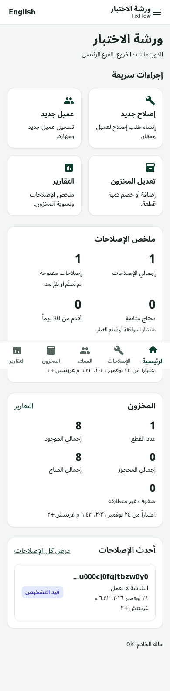
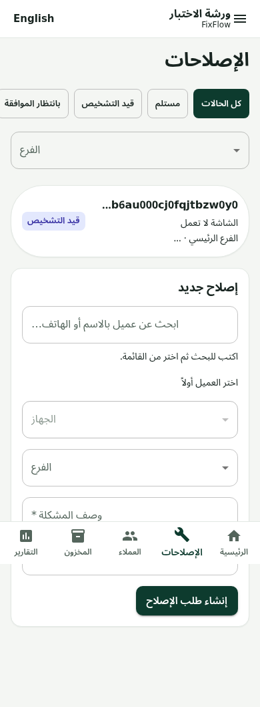
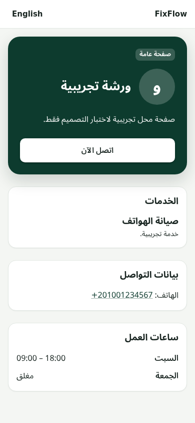
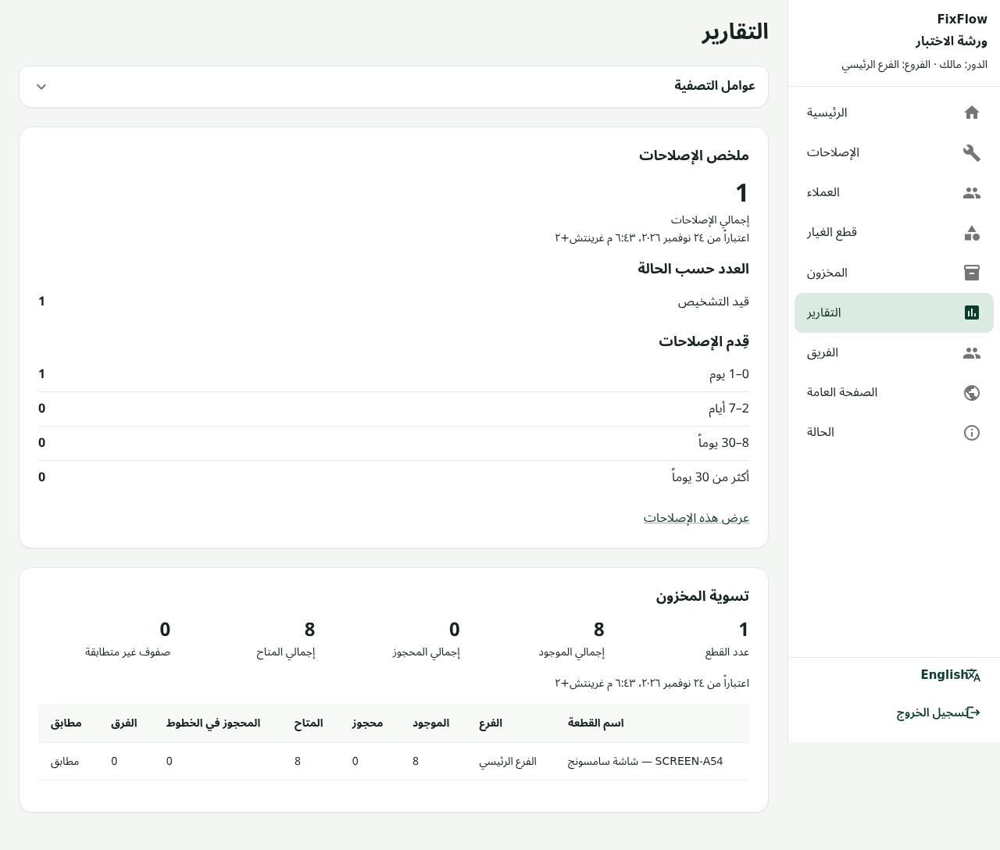

# FixFlow

Arabic-first (RTL, English supported) multi-tenant SaaS for repair shops. Each shop gets customers, devices, repair orders with a status workflow, parts inventory, reports, and its own public landing page.

**Demo status:** a development project, not a finished commercial product. No billing, no integrations, demo data only.

Live demo: https://fixflow-demo-y125.onrender.com (the free host sleeps when idle, the first load can take about a minute).

- Public shop page example: https://fixflow-demo-y125.onrender.com/s/demo-repair-shop
- Demo login (shared, fake data only, registration is disabled): `demo@example.local` / `uJ5kGoDsJLyF_ZNt`

## Screenshots

| Dashboard                                           | Repairs                                         | Public shop page                                        |
| --------------------------------------------------- | ----------------------------------------------- | ------------------------------------------------------- |
|  |  |  |



## What is inside

- **Multi-tenancy with database isolation:** PostgreSQL row-level security, with the app connecting as a non-owner role that cannot bypass it. See `docs/TENANCY.md`.
- **Auth:** short-lived access tokens, rotating refresh sessions in an HttpOnly cookie, Origin check, in-memory rate limits. See `docs/AUTH.md`.
- **Repairs:** status workflow, assignment, approvals, event history, URL-synced filters.
- **Inventory:** stock adjust, reserve, consume and release with idempotent writes.
- **Reports:** snapshot-consistent summaries.
- **Public shop page:** each shop publishes a landing page at `/s/<slug>` showing only an allow-listed set of fields.
- **Mobile-first PWA:** Arabic RTL layout, offline fallback, pending-operation recovery.

Stack: React + TypeScript + MUI (Vite), NestJS, Prisma, PostgreSQL.

## Run locally

```bash
cp .env.example .env        # replace every CHANGE_ME
npm ci --ignore-scripts
docker compose up -d        # PostgreSQL + Redis
npm run prisma:generate
npm run dev
```

Demo data (local only): set `DEMO_PASSWORD` and `DATABASE_OWNER_URL`, then run the seed in `apps/api`. It creates one fake shop, customer, device and a few repairs.

Checks: `npm run typecheck && npm run lint && npm test && npm run test:db`, plus the `test:*:http` scripts.

## Free hosting (Render + Neon)

`Dockerfile` builds one image where the API also serves the built web app (single origin). `render.yaml` is a blueprint for a free Render web service. The database is a free Neon Postgres. Create the non-owner app role from `docs/db/app-role.sql`, then set `DATABASE_URL` (app role), `MIGRATION_DATABASE_URL` (owner role) and `WEB_ORIGINS` in the Render dashboard. For a public demo set `REGISTRATION_ENABLED=false` and seed once with `ALLOW_DEMO_SEED=true`.

## Known limits

Rate limits are per process, not distributed. No dark mode, billing, or custom domains. The team page is read-only. Normal PostgreSQL 16 contention tests and Redis are not part of the demo deploy.

More detail is in `docs/` (architecture, design, security, workflows, development log).

## License

MIT, see `LICENSE`.
